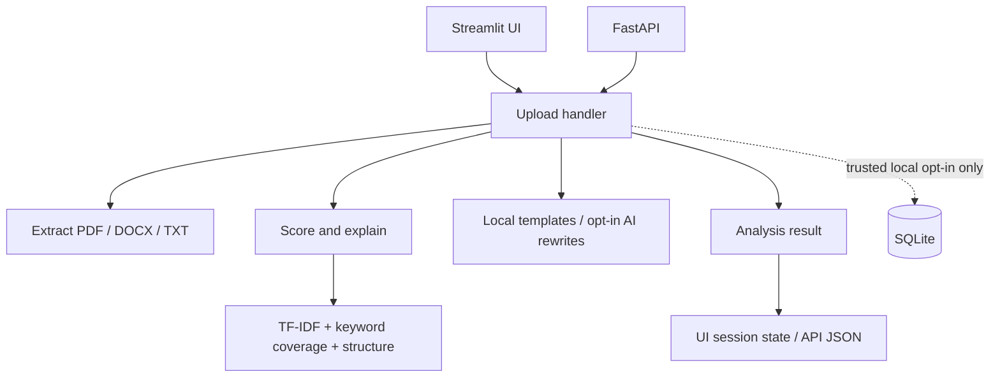

<div align="center">

# JobFit AI

### Read the role. Compare the evidence. Understand the score.

A Python resume-tailoring tool with explainable NLP scoring and a shared Streamlit / FastAPI core.

[](https://jobfit-ai-u9cgsvbwqbduxbhfpbsbls.streamlit.app/)
[](https://github.com/TJA0308/jobfit-ai/actions/workflows/tests.yml)
[](runtime.txt)
[](jobfit_ai/scoring.py)
[](api_server.py)

[Try it](#try-it-in-60-seconds) · [How it works](#how-scoring-works) · [Evaluation](#evaluation-development-versus-separate-checks) · [Run locally](#run-locally) · [Architecture](#architecture)

</div>

---

## Try it in 60 seconds

1. [Open the app](https://jobfit-ai-u9cgsvbwqbduxbhfpbsbls.streamlit.app/).
2. Click **Load demo job description**, then **Run demo ranking**. No resume or API key needed.
3. Open a candidate review to inspect the three score components and terms not found.

| Demo candidate | Alignment / 100 | Tier |
| --- | ---: | --- |
| Jordan Kim | 73.14 | Strong |
| Maya Singh | 55.44 | Strong |
| Marcus Lee | 32.84 | Moderate |
| Ethan Brooks | 25.66 | Weak |

Reproduce this example with `python scripts/demo_batch.py`. These are illustrative results, not hiring predictions.

| Explore the product | Explore the code | Understand the decisions |
| --- | --- | --- |
| [Live app](https://jobfit-ai-u9cgsvbwqbduxbhfpbsbls.streamlit.app/) | [Start at the upload handler](jobfit_ai/upload_handler.py) | [Interview walkthrough](DEFENSE.md) |
| [Sample resumes](demo/) | [Behavioral tests](tests/test_regressions.py) | [Deployment guide](docs/DEPLOYMENT.md) |

## What it does

Upload PDF, DOCX, or TXT resumes, paste a job description, and compare alignment scores. Each result shows text similarity, keyword coverage, document structure, terms not found, and editable bullet templates.

- Single and batch analysis: up to 10 resumes, 5 MB each.
- Shared Python core used by Streamlit and an optional FastAPI interface.
- Session-local recent results with a clear-results button.
- No API key needed. Optional AI rewrites require an explicit toggle.
- Demo resumes and reproducible evaluation scripts.

This is a resume-tailoring aid. It does not verify qualifications, reproduce an employer's ATS, or predict hiring outcomes.

## How scoring works

```text
Alignment = 0.45 × text similarity
          + 0.35 × keyword coverage
          + 0.20 × document structure
```

All components are on a 0–100 scale. Expand the explanation to inspect the math.

<details>
<summary><strong>Inside the score: components, thresholds, and tradeoffs</strong></summary>

1. **Text similarity:** fit TF-IDF on the resume and job description, compute cosine similarity, blend equally with job-vocabulary overlap, divide by a reference value of 0.45, and cap at 100.
2. **Keyword coverage:** select up to 45 frequent job-description tokens and measure how much of their frequency-weighted vocabulary appears anywhere in the resume. Missing terms are ordered by frequency, then alphabetically.
3. **Document structure:** combine length, detected section words, bullet count, and distinct action verbs.

Strong alignment starts at 50; Moderate starts at 30. These are heuristic thresholds originally selected using development examples. The weights are design choices. Reference scaling is not probability calibration, and cosine similarity itself can reach 1.

The default is lexical NLP, not a trained hiring model. An optional sentence-transformer backend remains available for local experiments; it is not enabled in the UI/API. The API field `semantic_similarity` retains its original name for compatibility; the UI calls it “Text similarity.”

</details>

## Evaluation: development versus separate checks

Run these from the repository root:

```bash
python scripts/evaluate.py
python scripts/evaluate.py --dataset eval/check_pairs.json
```

Results with the current default scorer:

| Dataset | Pairs / job descriptions | Mean Spearman | Tier agreement |
| --- | --- | --- | --- |
| Original development examples | 12 / 3 | 0.933 | 100% |
| Separate synthetic checks | 9 / 3 | 0.833 | 77.8% |

The original dataset helped select thresholds, so its results are not held-out accuracy. Its existing labels have no independently verified annotation provenance. The separate checks were AI-authored, with labels written before scoring; weights and thresholds were not retuned to them. They are a small behavioral check, not independent human validation.

A useful failure: a product candidate describing relevant experience through paraphrases ranks below a candidate repeating the job's wording. Another candidate with adjacent backend experience is assigned Weak instead of the expected Moderate. These failures remain visible rather than being tuned away.

Spearman measures ordering within each job, averaged across jobs. Tier agreement measures agreement with these subjective labels. Neither metric measures hiring success. Once these checks guide future tuning, new unseen examples will be needed.

<details>
<summary><strong>Run the optional embedding experiment</strong></summary>

```bash
pip install -r requirements-embeddings.txt
python scripts/evaluate.py --dataset eval/check_pairs.json --embeddings
```

Only `--embeddings` attempts to load/download the optional model. Historical embedding results are not claimed as results for the current scoring implementation.

</details>

## Architecture



Both interfaces use the same Python functions. The upload handler coordinates parsing, scoring, and rewrites in sequence; public requests do not use shared database history.

<details>
<summary><strong>Source map: where each responsibility lives</strong></summary>

| File | Responsibility |
| --- | --- |
| `streamlit_app.py` | UI, session state, demo, explicit rewrite choice |
| `api_server.py` | Multipart HTTP endpoints and safe error responses |
| `jobfit_ai/upload_handler.py` | Validate, parse, score, rewrite, clean temporary file |
| `jobfit_ai/resume_parser.py` | PDF text extraction, DOCX XML, UTF-8 TXT |
| `jobfit_ai/text_features.py` | Tokens, aliases, sections, names, action verbs |
| `jobfit_ai/semantic.py` | TF-IDF default and optional embeddings |
| `jobfit_ai/scoring.py` | Components, weighted score, tiers, suggestions |
| `jobfit_ai/history_store.py` | Optional local SQLite persistence |
| `scripts/evaluate.py` | Ranking and tier agreement reports |

</details>

## Run locally

<details open>
<summary><strong>Windows / PowerShell</strong></summary>

```powershell
git clone https://github.com/TJA0308/jobfit-ai.git
cd jobfit-ai
python -m venv .venv
.venv\Scripts\activate
pip install -r requirements.txt
streamlit run streamlit_app.py
```

</details>

<details>
<summary><strong>macOS / Linux</strong></summary>

```bash
git clone https://github.com/TJA0308/jobfit-ai.git
cd jobfit-ai
python3 -m venv .venv
source .venv/bin/activate
pip install -r requirements.txt
streamlit run streamlit_app.py
```

</details>

Use Python 3.13, then visit `http://localhost:8501`. Already cloned? Start at the virtual-environment step.

For the command-line demo:

```bash
python scripts/demo_batch.py
```

The demo currently ranks Jordan, Maya, Marcus, and Ethan in that order. Scores can change when scoring bugs are fixed; the demo is illustrative.

## Tests and optional API

```bash
pip install -r requirements-dev.txt
python -m unittest discover -s tests -v
uvicorn api_server:app --reload
```

For API-only installation, use `requirements-api.txt`. HTTP tests additionally require `httpx`, included in `requirements-dev.txt`.

| Method | Route | Purpose |
| --- | --- | --- |
| GET | `/health` | Health response |
| POST | `/match` | Analyze one upload |
| POST | `/match/batch` | Analyze and rank up to 10 uploads |

The old public `/history` route has been removed to prevent cross-user disclosure. API batches fail as a whole if a file is invalid; no analysis history is persisted. Streamlit reports individual file failures and shows successful results. Sync API handlers allow FastAPI to run blocking work in its thread pool.

Tests cover scoring regressions, parser behavior, upload cleanup/limits, explicit AI opt-in, session isolation, multipart API requests, and the demo. CI runs the same suite.

<details>
<summary><strong>Try a multipart API request</strong></summary>

With Uvicorn running, open [interactive API docs](http://127.0.0.1:8000/docs), or use:

```bash
curl -X POST http://127.0.0.1:8000/match \
  -F "job_description=<demo/job_description_software_engineering_intern.txt" \
  -F "resume_file=@demo/resume_jordan_kim_strong.txt"
```

On Windows, use `curl.exe` and put the command on one line.

</details>

For production configuration and the release checklist, see [Deployment](docs/DEPLOYMENT.md).

## Privacy and optional features

<details>
<summary><strong>What is stored, what is sent, and how to clear results</strong></summary>

The app processes uploads on the server. Its extraction temporary file is removed after processing. Recent results live in the current Streamlit session; “Clear session results” removes those results, not the contents of the upload widget. Refreshing/disconnecting can lose the session.

Public UI/API requests do not write analyses to SQLite or read shared history. Existing local databases are not deleted. Trusted local scripts can call `analyze_uploaded_bytes(..., persist_history=True)`; this stores analysis metadata and generated feedback, so do not expose that database publicly.

Optional AI rewrites use configured `OPENAI_API_KEY` and `OPENAI_MODEL` settings. Enabling the UI toggle sends resume/job excerpts to the external service and may spend credits. Credentials alone never enable requests. The public API uses local templates. Review any generated text for truthfulness before using it.

Timing measures the analysis pipeline before optional SQLite storage, not end-to-end network latency.

</details>

## Known limits and scope

- Lexical matching can reward copied job descriptions and miss paraphrases.
- “Terms not found” is not proof of missing ability; Go, C, and R can also be ambiguous words.
- Whole-document section detection and candidate-name inference are simple heuristics.
- PDFs need extractable text; OCR is not included. Complex layouts may parse poorly.
- No user accounts, distributed processing, or production-scale traffic guarantees.
- API size checks occur after multipart handling; a public API deployment would also need proxy/request limits and abuse controls.
- Small synthetic datasets do not establish fairness or suitability for hiring decisions.

The next useful improvement is better evidence and evaluation, not more infrastructure.

## Resume description

> Built a Python resume-matching application with shared Streamlit/FastAPI logic, explainable NLP scoring, session-local results, and automated regression tests.

Use the accompanying walkthrough to explain the implementation and limitations in your own words.

---

[Back to top](#jobfit-ai) · [Project status](STATUS.md) · [Report a bug](https://github.com/TJA0308/jobfit-ai/issues)
