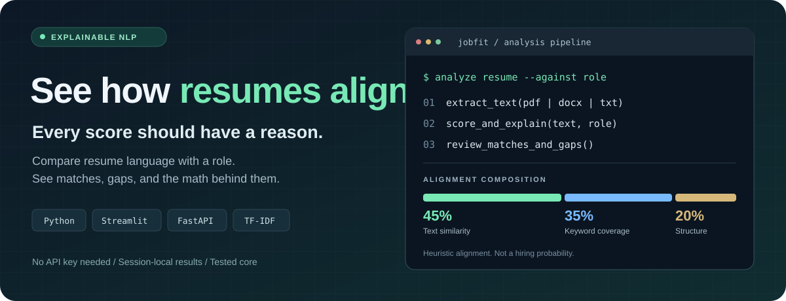
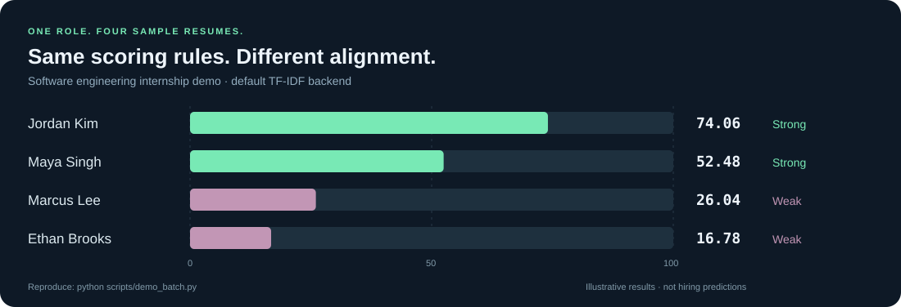
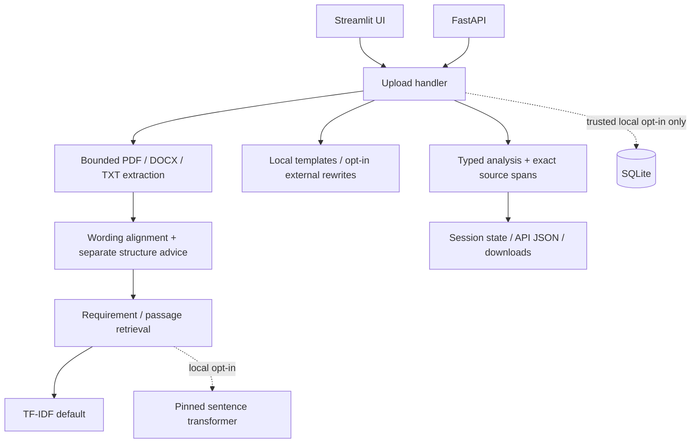

<div align="center">

# JobFit AI

### Compare requirements. Inspect the resume evidence.

[](https://jobfit-ai-u9cgsvbwqbduxbhfpbsbls.streamlit.app/)

A Python resume-tailoring application with passage retrieval, source attribution, and a shared Streamlit / FastAPI core.

[](https://jobfit-ai-u9cgsvbwqbduxbhfpbsbls.streamlit.app/)
[](https://github.com/TJA0308/jobfit-ai/actions/workflows/tests.yml)
[](runtime.txt)
[](api_server.py)

[Try it](#try-it-in-60-seconds) · [Evidence](#what-the-review-shows) · [Evaluation](#evaluation) · [Run locally](#run-locally) · [Interview walkthrough](DEFENSE.md)

</div>

## Try it in 60 seconds

1. Open the app and click **Run demo ranking**. No upload or API key is needed.
2. Open a candidate review, then expand a **Requirement evidence** row.
3. Compare the requirement with the exact resume excerpt and section.
4. Inspect a gap or review flag, then download the text review or JSON evidence.

The cloud app follows the deployed `main` branch. A local checkout can contain newer features; see [release verification](docs/DEPLOYMENT.md).

[](https://jobfit-ai-u9cgsvbwqbduxbhfpbsbls.streamlit.app/)

*These are project illustrations, not app screenshots. The chart uses actual scoring-v2 output from `python scripts/demo_batch.py`.*

| Demo resume | Wording alignment / 100 | Tier |
| --- | ---: | --- |
| Jordan Kim | 74.06 | Strong |
| Maya Singh | 52.48 | Strong |
| Marcus Lee | 26.04 | Weak |
| Ethan Brooks | 16.78 | Weak |

Scores describe wording alignment, not hiring suitability. [Demo files](demo/) are fictional.

## What the review shows

Each extracted requirement is paired with an exact resume passage, its section, and character offsets into the extracted text. Evidence is retrieved from the source; it is never generated by an LLM.

| Result | Meaning |
| --- | --- |
| Experience wording found | Related wording in an experience/project passage; verify the claim |
| Partial wording / mention | Related terms or a skill-list mention; may cover only part of the requirement |
| No evidence found | Retrieval found no sufficiently related passage; not proof of missing ability |
| Review required | Obvious near-copying or explicit negation needs inspection |

For example, `Build Python services with SQL storage` can retrieve `Built a Python service with SQL storage for cafe orders` from Projects. A bare `Python SQL` skills list remains a partial mention. `No experience with Python or SQL` is flagged for review.

Reviews also include matching vocabulary, priority terms not found, separate document-structure advice, editable bullet templates, and downloadable TXT/JSON reports. Compare up to 10 PDF/DOCX/TXT resumes in one batch.

## How matching works

```text
Upload → validate → extract text → split requirements/passages
                                      ↓
                            retrieve exact resume excerpts
                                      ↓
                        review flags + source-attributed report
```

Two related views are kept separate:

- **Wording alignment:** `0.60 × text similarity + 0.40 × keyword coverage`. Formatting does not affect alignment.
- **Requirement evidence:** retrieve a passage for each requirement, then apply section/copy/negation rules. Retrieval similarity is not confidence in qualification.

Default text similarity blends pairwise TF-IDF cosine and job-vocabulary overlap, divides by a heuristic reference of 0.45, and caps at 100. Keyword coverage uses frequency weights for up to 45 job tokens. Strong starts at 50; Moderate at 30. These choices are not calibrated probabilities.

Lexical passage retrieval combines requirement-token coverage (65%) and TF-IDF cosine (35%). Experience/project passages with at least 60% token coverage can receive the experience-wording label; matches below 20% coverage are omitted. Skill-list mentions remain partial. See [design notes](docs/architecture.md) for rules and limitations.

An optional local `all-MiniLM-L6-v2` retriever searches bounded passages for paraphrases. Its model revision is pinned. The deployment must enable it, and the user must select it. Unavailable models fall back explicitly to lexical matching. Neither matching mode needs an external API key.

## Evaluation

Committed [JSON reports](eval/reports/) include dataset hashes, runtime/package versions, actual backends, per-example results, and failures.

| Ranking set | Size | Hybrid lexical Spearman | NDCG@3 | Tier agreement |
| --- | --- | ---: | ---: | ---: |
| Original development examples | 12 pairs / 3 jobs | 0.933 | 0.976 | 100% |
| Previously separate synthetic checks | 9 pairs / 3 jobs | 0.833 | 0.974 | 77.8% |

Keyword-only, raw TF-IDF cosine, and the hybrid have the same ordering on these small sets. Local embeddings also score 0.833 Spearman on the nine checks. **These experiments do not establish a ranking improvement.** Raw-baseline tiers share heuristic thresholds and are not calibrated comparisons.

The [evidence development fixtures](eval/evidence_cases.json) ask a different question: does retrieval return the expected excerpt or correctly abstain?

| Evidence backend | Top-1 excerpt retrieval, 21 positive cases | Exact excerpt or abstention, all 24 | Status agreement | Source attribution |
| --- | ---: | ---: | ---: | ---: |
| Lexical | 85.7% | 87.5% | 87.5% | 100% |
| Local embeddings | 100% | 100% | 70.8% | 100% |

Dense retrieval finds three paraphrases missed by lexical retrieval, but labels seven expected experience matches as partial. Neither backend produces a false experience-support label on these fixtures. This is a small authored suite, not an estimate of real-world error rates. Source attribution checks that excerpts equal the original text slices; it does not establish relevance or truth.

All labels are synthetic or lack independently verified annotation provenance. Original examples influenced threshold selection. The nine checks have now been inspected during development and are no longer an untouched test set. The 24 evidence fixtures were AI-authored before their first benchmark run and include intentional hard cases. There is no human-validated hiring dataset here. See [evaluation protocol](docs/EVALUATION.md).

```bash
python scripts/evaluate.py --compare --json-output eval/reports/development.json
python scripts/evaluate.py --dataset eval/check_pairs.json --compare --json-output eval/reports/checks.json
python scripts/evaluate_evidence.py --json-output eval/reports/evidence-lexical.json
```

For the optional experiment, install `requirements-embeddings.txt` and add `--embeddings`. This can download model weights; reports record whether embeddings were actually used.

## Architecture



| Module | Responsibility |
| --- | --- |
| `upload_handler.py` | Validation, orchestration, timing, temporary-file cleanup |
| `resume_parser.py` | Extraction with page, expanded-XML, and text limits |
| `evidence.py` | Bounded passages, exact offsets, retrieval, review rules |
| `semantic.py` | Default lexical signal and optional local model |
| `scoring.py` | Versioned wording score and separate structure advice |
| `reports.py` | Session-local text/JSON export |
| `models.py` | Shared typed response contract |

UI and API invoke the same core directly. Public requests do not read or write shared SQLite history. See [architecture and tradeoffs](docs/architecture.md).

## Run locally

Use Python 3.13.

```powershell
git clone https://github.com/TJA0308/jobfit-ai.git
cd jobfit-ai
python -m venv .venv
.venv\Scripts\Activate.ps1
python -m pip install -r requirements-dev.txt
python -m streamlit run streamlit_app.py
```

On macOS/Linux, use `python3 -m venv .venv` and `source .venv/bin/activate`. Open `http://localhost:8501`. UI-only installation uses `requirements.txt`.

```bash
python -m unittest discover -s tests -v
python scripts/demo_batch.py
python -m uvicorn api_server:app --reload
```

| Method | Route | Purpose |
| --- | --- | --- |
| GET | `/health` | Health response |
| POST | `/match` | Analyze one upload; includes evidence and review flags |
| POST | `/match/batch` | Analyze and compare up to 10 uploads |

Open `http://127.0.0.1:8000/docs` for interactive multipart requests. API batches fail as a whole on invalid input; the UI retains successful files and shows per-file errors. [Deployment guide](docs/DEPLOYMENT.md) includes optional model configuration and the live smoke check.

## Privacy and limits

- Uploads are processed on the server; extraction temporary files are removed after processing.
- Recent reviews live in the current Streamlit session. **Clear session results** removes reviews/history, not upload-widget contents.
- Reports contain resume excerpts. Downloads belong to the current session and are not published or stored in shared history.
- Matching defaults to local lexical processing. Embeddings require deployment and user opt-in. Model weights are cached; resume embeddings are not cached across requests.
- External AI rewrites require explicit opt-in plus credentials. They send resume/job excerpts to the provider and may spend credits. The public API uses local templates.
- Limits: 5 MB/file, 10 files/batch, 30 PDF pages, 2 MB expanded DOCX document XML, 100,000 extracted resume characters, 20,000 job-description characters. Retrieval reviews up to 30 distinct requirement passages and 200 resume passages; truncation is reported.
- No OCR. Complex layouts and hard-wrapped sentences can reduce quality. Offsets refer to extracted text, not PDF coordinates.
- Copy/negation rules catch obvious patterns, not arbitrary deception or logical contradiction. Copied wording can still inflate scores.
- A public API needs deployment-level request limits and abuse controls. Application checks follow multipart parsing. No production-scale or fairness guarantees are claimed.

## Discuss the project

Use the [interview walkthrough](DEFENSE.md) to trace a request, explain retrieval, show a failure, and practice a small code change. The [90-second demo script](docs/DEMO.md) provides a repeatable walkthrough.

A factual resume description:

> Built a Python resume-tailoring app with shared Streamlit/FastAPI logic, exact requirement-to-resume evidence, downloadable reports, and regression tests; compared lexical and local embedding retrieval on documented synthetic fixtures.

Describe the implementation and measurements you can explain yourself. Avoid claiming ATS accuracy or verified hiring suitability.
