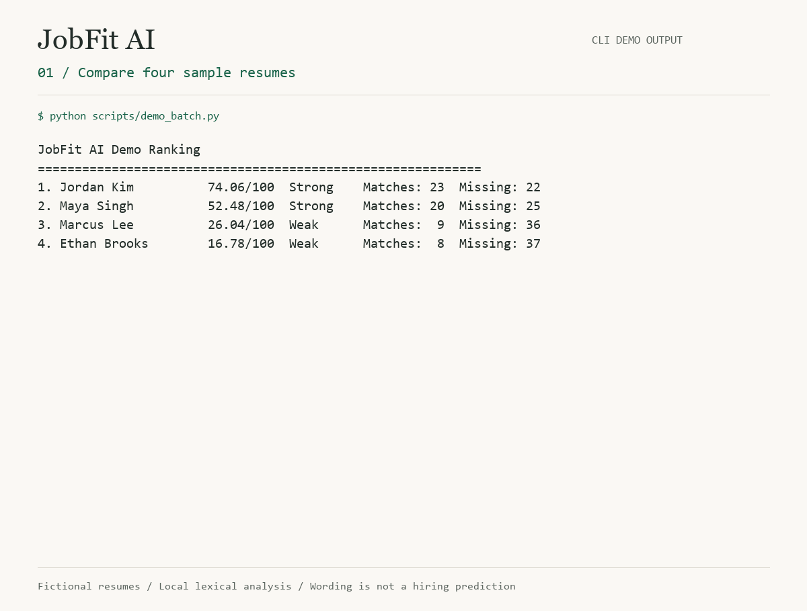
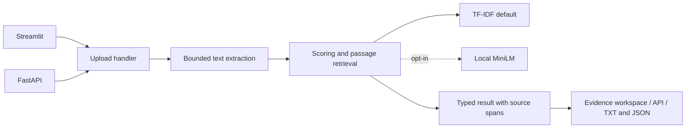

# JobFit AI

Compare job requirements with exact passages from a resume. Built with Python, Streamlit, FastAPI, and a TypeScript evidence workspace.

[](https://jobfit-ai-u9cgsvbwqbduxbhfpbsbls.streamlit.app/)

[](https://github.com/TJA0308/jobfit-ai/actions/workflows/tests.yml)
[](runtime.txt)
[](api_server.py)

[Live app](https://jobfit-ai-u9cgsvbwqbduxbhfpbsbls.streamlit.app/) · [Quick start](#quick-start) · [API](#api) · [Development](#development) · [Evaluation](#evaluation) · [Documentation](#documentation)

## Overview

Upload a resume and paste a job description to inspect which requirements have related wording, which appear only as skill mentions, and which have no retrieved evidence. Every returned excerpt includes its source section and character offsets into the extracted text.

The app separates **wording alignment** from **requirement evidence**. Its score is a heuristic review aid, not an ATS score, hiring probability, or verification of qualifications. Evidence passages are retrieved from the resume rather than generated by an LLM.

- Accept PDF, DOCX, and TXT; compare up to ten resumes per batch.
- Inspect exact excerpts with browser-local search, filtering, and selection.
- Flag obvious copied job wording and explicit negation for review.
- Export session-local TXT and JSON reports.
- Use the same typed analysis core through Streamlit or FastAPI.
- Run lexical matching without an API key; optionally enable local MiniLM retrieval or external bullet rewrites.

## Demo

[](https://jobfit-ai-u9cgsvbwqbduxbhfpbsbls.streamlit.app/)

*Analysis output rendered as a CLI animation, using fictional samples. This is not a browser recording. [Static preview](docs/assets/demo-preview.png) · [Transcript](docs/assets/demo-output.txt)*

In the [live app](https://jobfit-ai-u9cgsvbwqbduxbhfpbsbls.streamlit.app/):

1. Click **Run demo ranking**. No upload or API key is required.
2. Choose a candidate under **Review a resume**.
3. Select a requirement to inspect the excerpt and its **Source details**.
4. Try **Tailoring** and **Score details**, then download a report.

Browser screenshots, responsive layout checks, and the deployed upload/download smoke check remain pending. See [release verification](docs/RELEASE_CHECK.md).

## Quick start

Requires **Python 3.13**. From PowerShell:

```powershell
git clone https://github.com/TJA0308/jobfit-ai.git
cd jobfit-ai
python -m venv .venv
.venv\Scripts\Activate.ps1
python -m pip install -r requirements-dev.txt
python -m streamlit run streamlit_app.py
```

Open <http://localhost:8501>. On macOS/Linux, create the environment with `python3 -m venv .venv` and activate it with `source .venv/bin/activate`.

Install from the repository root: requirements include the local evidence component. Its compiled frontend assets are committed, so running the app does not require Node. For a UI-only installation, use `requirements.txt` instead of `requirements-dev.txt`.

To run the fictional demo without the UI:

```sh
python scripts/demo_batch.py
python scripts/demo_evidence.py --candidate jordan --status supported
python scripts/demo_evidence.py --candidate ethan --status not_found
```

## Architecture



The UI calls the Python core directly; it does not need a separate API server. Public entry points do not persist analyses to shared SQLite history. Dense scoring and evidence retrieval reuse inference within one analysis, without caching resume text or vectors across requests.

```text
api_server.py          FastAPI routes and request logging
streamlit_app.py       Upload and evidence-review interface
jobfit_ai/             Parsing, scoring, retrieval, models, and reports
components/            Packaged TypeScript evidence workspace
tests/                 Core, HTTP, input-fidelity, and Streamlit tests
scripts/               Demos, evaluations, benchmarks, and asset checks
eval/                  Development fixtures and reproducible JSON reports
demo/                  Fictional resumes and adversarial examples
docs/                  Architecture, deployment, evaluation, and demo guides
```

### Matching behavior

Alignment uses `0.60 * text similarity + 0.40 * keyword coverage`. Default text similarity blends pairwise TF-IDF cosine and vocabulary overlap, with heuristic scaling. Document structure is reported separately and does not affect alignment.

Requirement retrieval uses token coverage and TF-IDF similarity by default:

| State | Interpretation |
| --- | --- |
| Experience wording found | Related wording in an experience/project passage; verify the claim |
| Partial wording / mention | Related terms or a skill-list mention; may cover only part of a requirement |
| No evidence found | No sufficiently related passage retrieved; not proof of missing ability |
| Review required | Obvious copying or explicit negation needs inspection |

Optional `all-MiniLM-L6-v2` retrieval uses a pinned model revision and reports lexical fallback when unavailable. See [architecture and thresholds](docs/architecture.md) and [model configuration](docs/DEPLOYMENT.md#optional-local-semantic-matching).

## API

With `requirements-dev.txt` installed:

```sh
python -m uvicorn api_server:app --reload
```

Interactive documentation: <http://127.0.0.1:8000/docs>.

| Method | Route | Purpose |
| --- | --- | --- |
| GET | `/health` | Health response |
| POST | `/match` | Analyze one multipart upload |
| POST | `/match/batch` | Analyze and rank up to ten uploads |

Example request from the repository root (use `curl.exe` in PowerShell):

```sh
curl -X POST http://127.0.0.1:8000/match -F "job_description=Build Python services with SQL storage." -F "resume_file=@demo/resume_jordan_kim_strong.txt"
```

Responses include scores, backend names, requirement evidence, exact offsets, warnings, and timings. A server-generated `X-Request-ID` correlates operational logs without recording resume/job text or filenames. Invalid files fail an API batch as a whole; the UI retains successful files and displays per-file errors.

## Development

From the repository root, with the virtual environment active:

```sh
python -m unittest discover -s tests -v
python -m pip check
python scripts/verify_component.py
python scripts/check_openings.py
```

The current suites contain **81 Python tests and 5 frontend DOM tests**. Coverage includes exact source attribution, corrupt uploads, input limits, Unicode/DOCX fidelity, API contracts, session isolation, exports, inference reuse, and operational logging. CI also rebuilds the frontend and checks committed assets.

For frontend changes, use **Node 24**:

```sh
cd components/jobfit-evidence/jobfit_evidence/frontend
npm ci
npm test
npm run build
```

Commit rebuilt assets with frontend changes. Reinstall the component from the repository root with `python -m pip install -e ./components/jobfit-evidence`. See the [component guide](components/jobfit-evidence/README.md).

## Evaluation

Committed [JSON reports](eval/reports/) record dataset hashes, runtime versions, actual backends, and individual failures. The evidence benchmark uses **24 authored development fixtures**, including 21 cases with expected excerpts:

| Backend | Exact top-1 excerpt, 21 cases | Excerpt or abstention, all 24 | Status agreement |
| --- | ---: | ---: | ---: |
| Lexical | 18/21 | 21/24 | 21/24 |
| Local MiniLM | 21/21 | 24/24 | 17/24 |

Both recorded runs preserve exact source attribution. Dense retrieval recovers three paraphrases missed by lexical matching, but its status agreement is lower. The ranking experiments do not establish an improvement over keyword-only or raw TF-IDF baselines.

These are small synthetic/development sets, not independent hiring validation. Human annotation and user studies remain outstanding. The posting scenarios also retain a counterexample where a skill list outscores project experience; alignment should not be treated as qualification ranking.

```sh
python scripts/evaluate.py --compare
python scripts/evaluate.py --dataset eval/check_pairs.json --compare
python scripts/evaluate_evidence.py
python scripts/benchmark.py
```

Optional dense evaluation requires `requirements-embeddings.txt`; add `--embeddings` to the evaluation command. Model weights may download. The benchmark disables downloads and records the actual backend, so fallback timings must not be described as dense performance.

See [evaluation protocol](docs/EVALUATION.md), [posting scenarios](docs/POSTING_SCENARIOS.md), [annotation rubric](docs/ANNOTATION.md), and [performance measurements](docs/PERFORMANCE.md).

## Privacy and limitations

- Uploads are processed on the server; extraction temporary files are removed after processing. Results and reports stay in the current Streamlit session rather than shared history.
- **Clear session results** removes reviews/history, but does not empty the upload widget. Downloaded reports contain resume excerpts.
- Matching defaults to local lexical processing. External rewrites require explicit opt-in and credentials, transmit excerpts to the provider, and may consume credits. API requests use local templates.
- Limits: 5 MB/file, ten files/batch, 30 PDF pages, 2 MB expanded DOCX document XML, 100,000 resume characters, and 20,000 job-description characters. Retrieval caps at 30 distinct requirements and 200 resume passages, with warnings.
- No OCR. Complex layouts and hard-wrapped text can reduce quality. Offsets refer to extracted text, not PDF coordinates.
- Scores and evidence labels do not verify skills, eligibility, employment, or hiring suitability. Copy/negation rules catch narrow patterns; copied wording can still inflate alignment.
- Broad public API exposure requires deployment-level request limits and abuse controls. Application checks occur after multipart parsing. Production scale and fairness have not been established.

## Documentation

| Guide | Contents |
| --- | --- |
| [Architecture](docs/architecture.md) | Retrieval rules, scoring choices, and tradeoffs |
| [Deployment](docs/DEPLOYMENT.md) | Hosting, optional models, logging, and smoke checks |
| [UI](docs/UI.md) | Component behavior, session state, and verification boundaries |
| [Demo](docs/DEMO.md) | Repeatable 90-second walkthrough and failure cases |
| [Technical walkthrough](docs/technical-walkthrough.md) | Request trace, scoring examples, and regression history |
| [Project status](STATUS.md) | Completed work and remaining verification |
